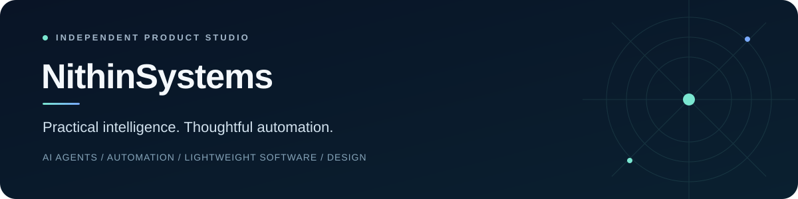

  

  <strong>Building useful systems for a more automated world.</strong> 
  Clear ideas. Thoughtful design. Tools made to solve real problems.

 

## The idea

Technology should make everyday work feel simpler. **NithinSystems** is an independent initiative exploring how AI, automation, software and design can help people work with less friction.

I'm learning and building in public—starting with focused ideas, making the work understandable, and improving it through feedback.

 

## What I'm building

<table>
<tr>
<td width="50%" valign="top">

### ✦ AI agents & assistants
Purposeful AI workflows designed around specific tasks and human oversight.

</td>
<td width="50%" valign="top">

### ◈ Automation templates
Reusable starting points that make repetitive business processes easier to manage.

</td>
</tr>
<tr>
<td width="50%" valign="top">

### ⌘ Lightweight tools
Small software products and experiments built around clear, practical needs.

</td>
<td width="50%" valign="top">

### ◇ UI/UX resources
Thoughtful interfaces and digital resources that make technology more approachable.

</td>
</tr>
</table>

 

## On the workbench

### Invoice Follow-up Starter

An early local prototype that turns overdue invoice information into reminder drafts for human review. It is being improved and tested before public release.

`Python` &nbsp; `Invoice workflows` &nbsp; `Human review` &nbsp; **In development**

 

## How I work

**Start with the problem.** Build for a real task instead of adding complexity for its own sake.

**Make the work understandable.** Provide clear instructions and examples as projects become ready to share.

**Be honest about progress.** Share limitations, learn from feedback and improve in public.

 

---

  <strong>One useful product at a time.</strong> 
  Follow <a href="https://github.com/NithinSystems">NithinSystems</a> to see what I'm building.

